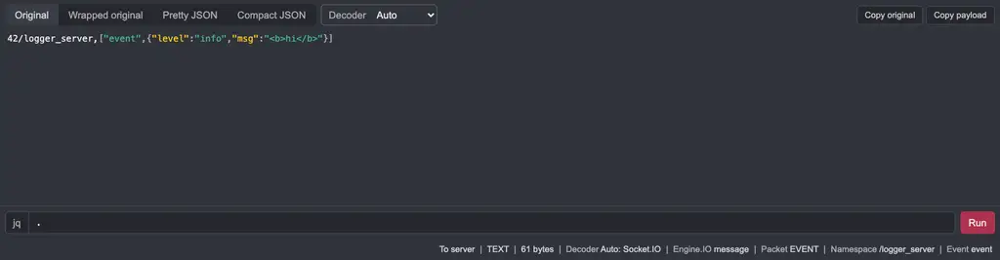
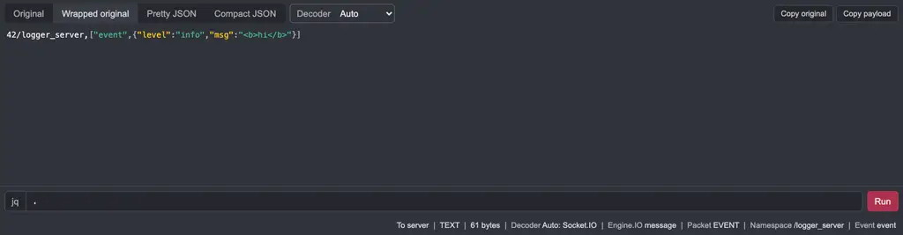
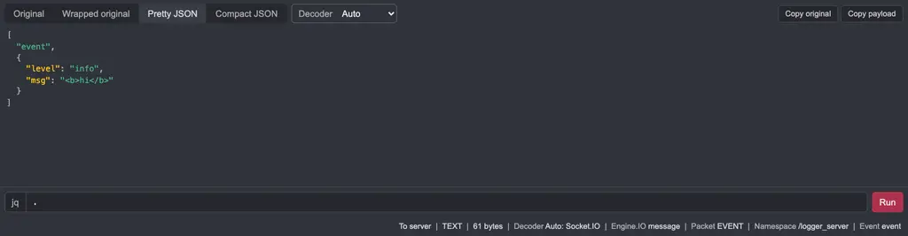
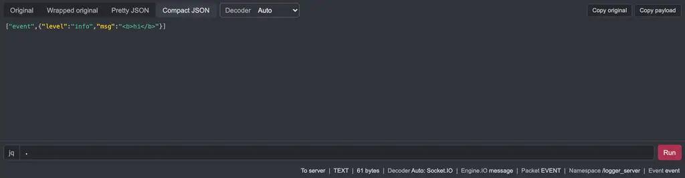
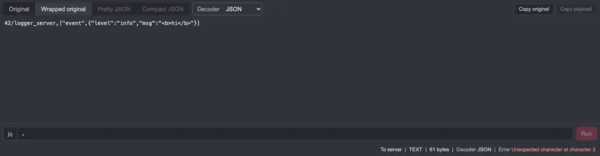
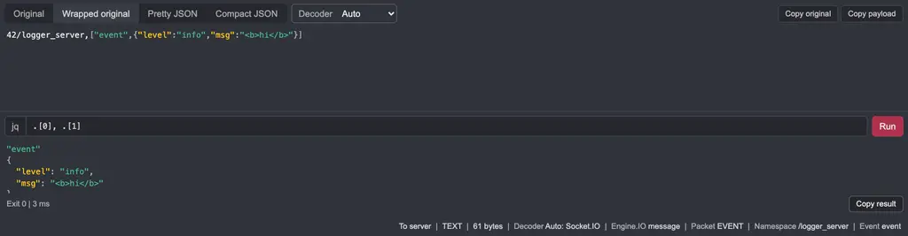
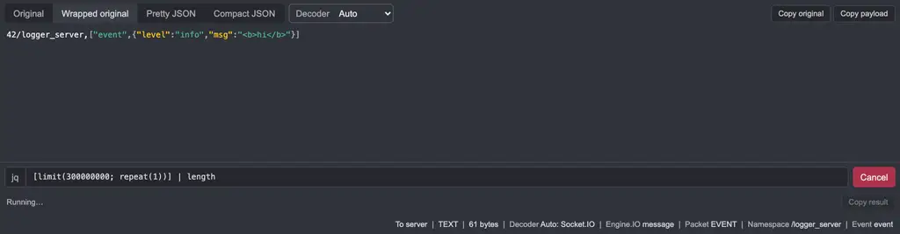

# Live acceptance in Caido

Run on 2026-10-30 against Caido v0.59.0 with the packaged `dist/plugin_package.zip` (version 0.1.0) installed through **Plugins > Install Package**. The traffic is synthetic: `/tmp/wireglass-traffic.ts` sends Socket.IO frames to a local echo server on `127.0.0.1:9871` through the Caido proxy. The screenshots show only the Wireglass pane.

The scenario drives the installed plugin with the harness headless browser. It selects message 2 of the `127.0.0.1:9871` connection:

```text
42/logger_server,["event",{"level":"info","msg":"<b>hi</b>"}]
```

## Results

|Step|Observed|
|---|---|
|Original preset|Original text, no wrapping, payload highlighted in place|
|Wrapped original preset|Same text, wrapped|
|Pretty JSON preset|Payload array indented with two spaces|
|Compact JSON preset|`["event",{"level":"info","msg":"<b>hi</b>"}]`|
|Decoder Raw|`Decoder Raw (not parsed)`; Copy payload disabled|
|Decoder JSON|`Error Unexpected character at character 3`; original text unchanged|
|Decoder Socket.IO|`Engine.IO message`, `Packet EVENT`, `Namespace /logger_server`, `Event event`|
|Decoder Auto|`Decoder Auto: Socket.IO` with the same packet facts|
|Override on message 3 of the same connection|Decoder stays Raw|
|jq `.[0], .[1]`|`"event"` and the first argument object; status `Exit 0 \| 3 ms`|
|jq `[limit(300000000; repeat(1))] \| length`, then Cancel|Status `Cancelled`|
|Run again, then select messages 3, 6, 7, 1, 2 quickly|Run stopped; result cleared; Run button shown|
|Content after all steps|Equal to the original text|


## Screenshots









## Unsupported behavior

- Binary frames did not offer the Wireglass view in this run. They do now, for the LZ4 decoder; see `wiki/Home.md`. Socket.IO binary attachments are counted, not reconstructed.
- Decoder overrides last until the project changes or Caido reloads.
